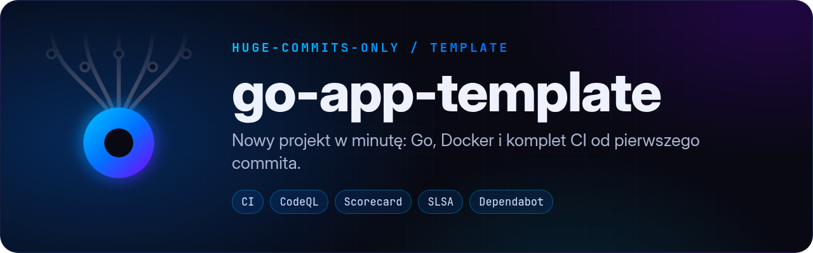
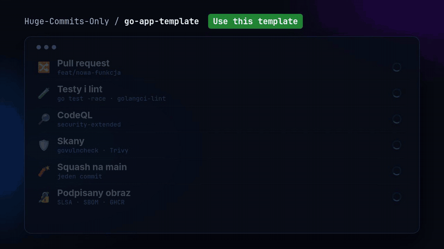

<p align="center">
  
</p>

<p align="center">
  <a href="https://github.com/Huge-Commits-Only/go-app-template/generate"></a>
</p>

<p align="center">
  <a href="https://github.com/Huge-Commits-Only/go-app-template/actions/workflows/unit-test.yml"></a>
  <a href="https://github.com/Huge-Commits-Only/go-app-template/actions/workflows/codeql.yml"></a>
  <a href="https://scorecard.dev/viewer/?uri=github.com/Huge-Commits-Only/go-app-template"></a>
  
</p>

<p align="center">
  
</p>

Start każdego nowego projektu w **Huge Commits Only**: aplikacja w Go z testami, obraz Dockera dla Raspberry Pi i komplet CI — na zielono od pierwszego commita.

## ✨ Co dostajesz
- **🎯 Go** — minimalny serwer HTTP z `/healthz` i testami (pokrycie powyżej 80%); `app -health` to health check kontenera.
- **🐳 Docker** — kompilacja krzyżowa amd64 / arm64, obraz `scratch`, użytkownik bez uprawnień, obraz bazowy przypięty do skrótu.
- **🔒 Bezpieczeństwo** — CodeQL `security-extended`, govulncheck, Trivy, OpenSSF Scorecard; akcje przypięte do SHA, minimalne uprawnienia.
- **🔏 Podpisane obrazy** — atestacja pochodzenia (SLSA) i SBOM przy każdym merge'u.
- **🤖 Porządek** — Dependabot co tydzień, etykiety z nazwy brancha, autor i reviewer w PR, szkic wydania.

## 🚀 Nowy projekt
- [ ] **[Use this template](https://github.com/Huge-Commits-Only/go-app-template/generate)**, właściciel `Huge-Commits-Only`. Zacznij od repozytorium **prywatnego**; publiczne dopiero po przejrzeniu pod kątem sekretów i danych osobowych.
- [ ] Zmień nazwę modułu w `go.mod` (`module app`) i katalogu `cmd/app`, a w `Dockerfile` ścieżkę `./cmd/app`.
- [ ] Nadaj aplikacji **własną identyfikację**: logo, okładka w `.github/assets/`, GIF z demo i ten README.
- [ ] **Settings → Rules → Rulesets**: ochrona `main` (tylko PR ze squashem, bez force-pusha i usuwania, wymagane testy CI). Szablon nie przenosi ustawień repozytorium; dla repo prywatnych wymaga planu płatnego.
- [ ] **Settings → Social preview**: obrazek 1280 × 640 w stylu aplikacji.
- [ ] Repozytorium publiczne: po pierwszej publikacji ustaw obraz w **Packages** jako publiczny.

```bash
go vet ./... && go test ./...
PORT=18080 go run ./cmd/app   # http://localhost:18080/
```

<details>
<summary><b>🔄 Workflowy</b></summary>
<br>

| Workflow | Plik | Kiedy | Co robi |
|---|---|---|---|
| Go Verification | `go-test.yml` | PR, `main` | `go mod verify`, `go mod tidy -diff`, `gofmt`, kompilacja |
| Unit Test Verification | `unit-test.yml` | PR, `main` | `go test -race`, pokrycie i próg minimalny (80%) |
| Lint Verification | `lint-test.yml` | PR, `main` | `golangci-lint` |
| Security Verification | `security-test.yml` | PR, `main` | `govulncheck` + Trivy (podatności, sekrety, konfiguracja) |
| CodeQL Verification | `codeql.yml` | PR, `main`, co tydzień | CodeQL `security-extended` dla Go i workflowów (darmowy w repo publicznych) |
| Container Verification | `container-test.yml` | PR | Buduje obraz, sprawdza `/healthz`, skanuje Trivy |
| Workflow Verification | `workflow-test.yml` | PR, `main` | `actionlint` |
| Scorecard Verification | `scorecard.yml` | `main`, co tydzień | OpenSSF Scorecard (repo publiczne) |
| Dependabot Auto-Merge | `dependabot-auto-merge.yml` | PR od Dependabota | Łatki i drobne wersje scalają się same po przejściu wymaganych checków; duże wersje czekają na człowieka. Merge tokenem workflowu nie uruchamia workflowów na `main` — obraz z nową zależnością powstaje przy następnym merge'u |
| PR Automation | `pr-automation.yml` | nowy PR | Autor, reviewer i etykiety z nazwy brancha |
| Release Draft | `release-draft.yml` | `main` | Szkic notatek wydania |
| Docker Image Publish | `docker-build.yml` | `main` | Obraz amd64 + arm64 w GHCR z atestacją pochodzenia i SBOM (atestacja: repo publiczne) |

Sam szablon niczego nie publikuje. Etykiety z nazwy brancha: `feat/*` → `enhancement` · `fix/*` → `bug` · `docs/*` → `documentation` · `chore/*` → `chore` · `deps/*` → `dependencies`

</details>

---

<p align="center"><sub>Część <a href="https://github.com/Huge-Commits-Only"><b>Huge Commits Only</b></a> · licencja <a href="../LICENSE">MIT</a></sub></p>
