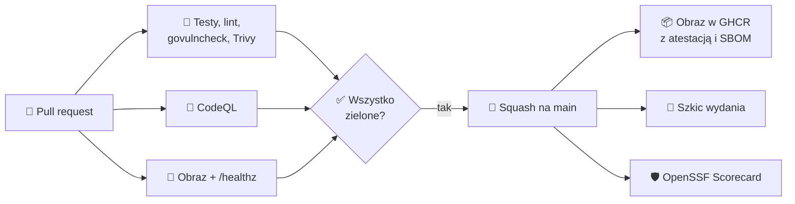

<div align="center">


<br>

[](../LICENSE)
[](../go.mod)
[](../Dockerfile)
[](https://www.raspberrypi.com/)
<br>
[](https://github.com/Huge-Commits-Only/go-app-template/actions/workflows/go-test.yml)
[](https://github.com/Huge-Commits-Only/go-app-template/actions/workflows/codeql.yml)
[](https://scorecard.dev/viewer/?uri=github.com/Huge-Commits-Only/go-app-template)

**[Nowy projekt](#-nowy-projekt-z-szablonu)** · **[Co jest w środku](#-co-jest-w-środku)** · **[CI/CD](#-cicd)** · **[Praca lokalna](#️-praca-lokalna)**

</div>

<br>

Szablon każdego nowego projektu w **Huge Commits Only**. Jedno kliknięcie i masz działającą aplikację w Go z testami, obrazem Dockera dla Raspberry Pi oraz kompletem CI: testy, lint, CodeQL, skany bezpieczeństwa, OpenSSF Scorecard i podpisane obrazy. Wszystko na zielono od pierwszego commita.

<table>
<tr>
<td width="33%" valign="top"><h3>🎯 Go</h3>Minimalny serwer HTTP z <code>/healthz</code> i testami, pokrycie powyżej 80%.</td>
<td width="33%" valign="top"><h3>🐳 Docker</h3>Kompilacja krzyżowa amd64 / arm64, obraz <code>scratch</code>, użytkownik bez uprawnień.</td>
<td width="33%" valign="top"><h3>🔒 Bezpieczeństwo</h3>CodeQL, govulncheck, Trivy, Scorecard, akcje i obrazy przypięte do skrótów.</td>
</tr>
<tr>
<td valign="top"><h3>🔏 Podpisane obrazy</h3>Atestacja pochodzenia (SLSA) i SBOM przy każdym merge'u.</td>
<td valign="top"><h3>🤖 Dependabot</h3>Co tydzień aktualizacje akcji, obrazu bazowego i modułów Go.</td>
<td valign="top"><h3>🏷️ Porządek w PR</h3>Etykiety z nazwy brancha, autor i reviewer, szkic wydania.</td>
</tr>
</table>

<br>

## 🚀 Nowy projekt z szablonu
- [ ] **Use this template → Create a new repository**, właściciel `Huge-Commits-Only`. Zacznij od repozytorium **prywatnego**; publiczne dopiero po przejrzeniu pod kątem sekretów i danych osobowych.
- [ ] Zmień nazwę modułu w `go.mod` (`module app`) i katalogu `cmd/app`, a w `Dockerfile` ścieżkę `./cmd/app`.
- [ ] Podmień ten README: opis, odznaki (nazwa repozytorium w adresach), sposób uruchomienia i baner w `.github/assets/`.
- [ ] **Settings → Rules → Rulesets**: ochrona `main` jak w `duet` (tylko PR ze squashem, podpisane commity, bez force-pusha i usuwania, wymagane testy CI). Szablon nie przenosi ustawień repozytorium. Dla repozytoriów prywatnych wymaga planu płatnego.
- [ ] **Settings → Social preview**: wgraj `.github/assets/social-preview.png` w wersji dla projektu.
- [ ] Repozytorium publiczne: po pierwszej publikacji ustaw obraz w **Packages** jako publiczny (darmowe miejsce bez limitu).

<br>

## 💻 Co jest w środku
| Element | Co robi |
|---|---|
| 🎯 `cmd/app` | Minimalny serwer HTTP z `/healthz` i testami; `app -health` to health check kontenera |
| 🐳 `Dockerfile` | Kompilacja krzyżowa (amd64 / arm64), obraz `scratch`, użytkownik bez uprawnień, obraz bazowy przypięty do skrótu |
| 🔍 `.golangci.yml` | Konfiguracja `golangci-lint` |
| 🤖 `.github/dependabot.yml` | Co tydzień: akcje, obraz bazowy i moduły Go |

<br>

## 🔄 CI/CD



<details>
<summary><b>Wszystkie workflowy</b></summary>
<br>

| Workflow | Plik | Kiedy | Co robi |
|---|---|---|---|
| Go Verification | `go-test.yml` | PR, `main` | `go mod verify`, `go mod tidy -diff`, `gofmt`, kompilacja |
| Unit Test Verification | `unit-test.yml` | PR, `main` | `go test -race`, pokrycie i próg minimalny (80%) |
| Lint Verification | `lint-test.yml` | PR, `main` | `golangci-lint` |
| Security Verification | `security-test.yml` | PR, `main` | `govulncheck` + Trivy (podatności, sekrety, konfiguracja) |
| CodeQL Verification | `codeql.yml` | PR, `main`, co tydzień | CodeQL `security-extended` dla Go i workflowów (darmowy w repo publicznych) |
| Container Verification | `container-test.yml` | PR | Buduje obraz, sprawdza `/healthz`, skanuje Trivy |
| Workflow Verification | `workflow-test.yml` | PR, `main` | `actionlint` |
| Scorecard Verification | `scorecard.yml` | `main`, co tydzień | OpenSSF Scorecard (repo publiczne) |
| PR Automation | `pr-automation.yml` | nowy PR | Autor, reviewer i etykiety z nazwy brancha |
| Release Draft | `release-draft.yml` | `main` | Szkic notatek wydania |
| Docker Image Publish | `docker-build.yml` | `main` | Obraz amd64 + arm64 w GHCR z atestacją pochodzenia i SBOM (atestacja: repo publiczne) |

Wszystkie akcje są przypięte do pełnego SHA, a workflowy dostają tylko potrzebne uprawnienia. Sam szablon niczego nie publikuje.

**Etykiety z nazwy brancha:** `feat/*` → `enhancement` · `fix/*` → `bug` · `docs/*` → `documentation` · `chore/*` → `chore` · `deps/*` → `dependencies`

</details>

<br>

## 🛠️ Praca lokalna
```bash
go vet ./... && go test ./...
PORT=18080 go run ./cmd/app   # http://localhost:18080/
```

<br>

<div align="center">
<a href="https://github.com/Huge-Commits-Only"></a>
<br>
<sub>Część <a href="https://github.com/Huge-Commits-Only"><b>Huge Commits Only</b></a> · licencja <a href="../LICENSE">MIT</a></sub>
</div>
